<h1 align="center">Mapa de viajes</h1>

  Un juego de viajes para tu web Joomla: tus usuarios suben álbumes de fotos a un mapa mundi, ganan puntos, compiten en un podio semanal y entran en sorteos. Todo vive en tu servidor, sin servicios de terceros.

  
  
  
  

  <a href="https://github.com/chaska/MapaViajes/releases/download/v1.18.1/pkg_mapaviajes-1.18.1.zip"><b>⬇ Descargar ahora: pkg_mapaviajes-1.18.1.zip</b></a> 
  Versión 1.18.1 · SHA-256 <code>f0b828cf8e5fb48a625a963a4a1bdc8401ea127917d86db6b5c47b4005ec38de</code> · <a href="../../releases/latest">todas las versiones</a>

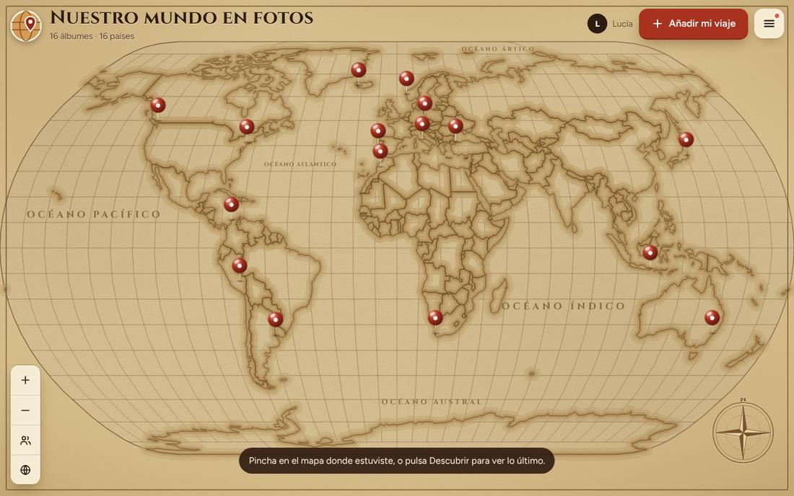

> Creado y dirigido por **ChasKa**, desarrollado con asistencia de IA (Claude, de Anthropic).

**Ir a:** [Qué hace](#qué-hace) · [Todas las opciones](#todas-las-opciones) · [Instalar](#instalar) · [Seguridad](#seguridad) · [Colaborar: traducciones](#colaborar-traducciones) · [Autor y licencia](#autor-y-licencia)

---

## Qué hace

| Función | En una frase |
|---|---|
| **Mapa mundi propio** | Seis estilos, chinchetas agrupadas por país que se separan al acercar, con las islas (Canarias, Baleares, Madeira, Azores) y la Antártida. |
| **Álbumes de fotos** | De 1 a 10 fotos por álbum con pie de foto, también desde el móvil y en formato HEIC (iPhone, Xiaomi). |
| **Amigos y fotos «solo amigos»** | Solicitudes de amistad, bloqueos y fotos que solo ven los amigos; siempre queda una pública como miniatura. |
| **Podio semanal y sorteos** | Puntos por viajes, fotos y participación; podio en estilo cómic y listado de participantes para sortear. |
| **Moderación** | Los álbumes pueden esperar tu aprobación, botón «Denunciar» para tus usuarios y un permiso propio para moderar. |
| **Códigos para artículos** | `{mapaviajes stats}` y compañía ponen los totales (álbumes, países, fotos) en cualquier artículo. |
| **Privacidad** | Sin cookies ni analítica propias; exportación y borrado de datos de cada persona (RGPD). |

**Probado en:** Joomla 6.1.4 con PostgreSQL y Joomla 6.2.0 con MariaDB 11.8.9. Requisitos: Joomla 5.4.9 / 6.1.4 o superior, PHP 8.1 o superior con GD (WebP), fileinfo e intl.

## Todas las opciones

### 1. El mapa (lo que ven tus usuarios)

| Botón o pantalla | Qué hace |
|---|---|
| **Añadir mi viaje** | Formulario para crear un álbum: busca el lugar o pincha en el mapa, pon título, año y de 1 a 5 fotos (por defecto) con su pie de foto. Marca cada foto como pública o «solo amigos». |
| **Menú ☰ › Descubrir** | Lista de lo último subido, los favoritos y la gente a la que sigues. |
| **Menú ☰ › Podio** | Podio de la semana, de la semana pasada y general, con los puntos de cada persona y cómo se puntúa. |
| **Menú ☰ › Amigos** | Solicitudes, amigos y bloqueados. |
| **Ficha de un viaje** | Fotos con flechas y miniaturas, «me gusta», «soy fan», seguir a la persona, comentarios (si activas un sistema), editar o borrar lo tuyo y «Denunciar». |
| **Personas** | Elige de quién quieres ver los viajes, o solo los de tus amigos. |

Ver la pantalla: el mapa en el móvil

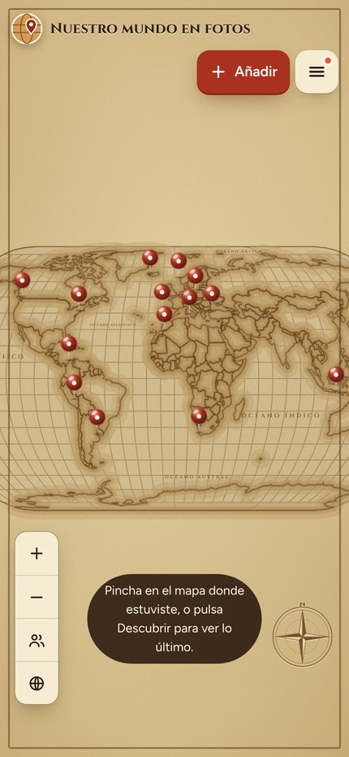

Ver la pantalla: el menú ☰

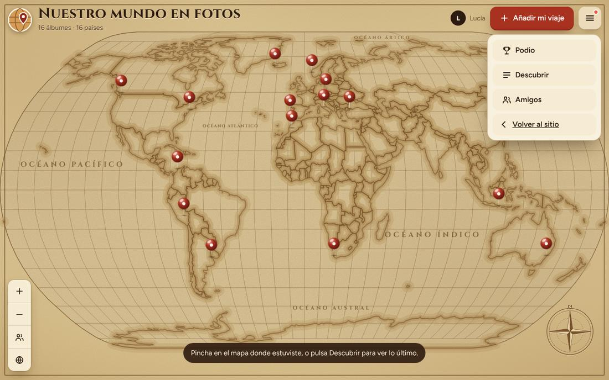

Ver la pantalla: Descubrir (lo último subido)

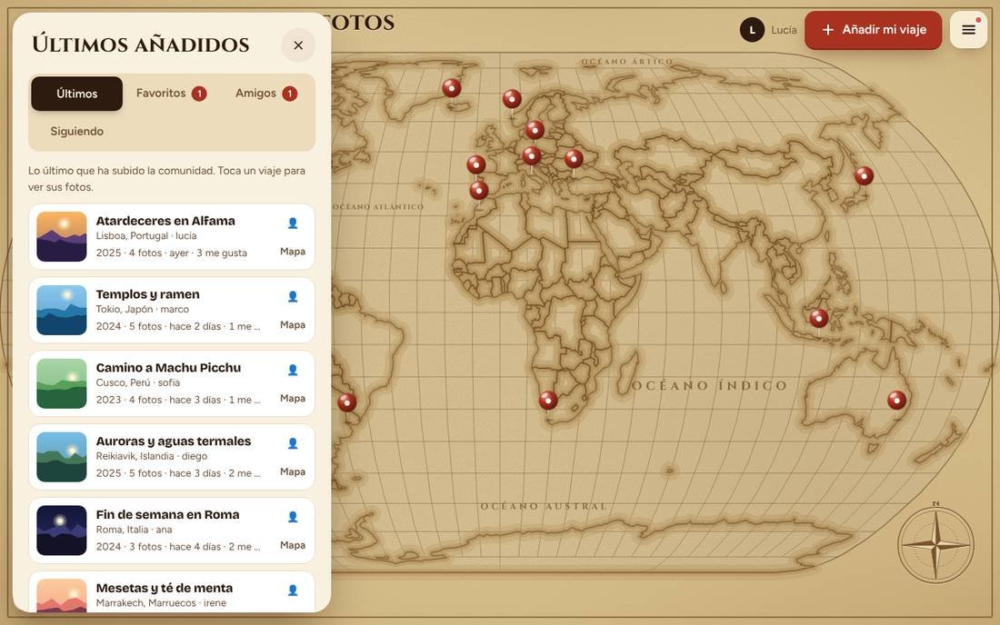

Ver la pantalla: la ficha de un viaje

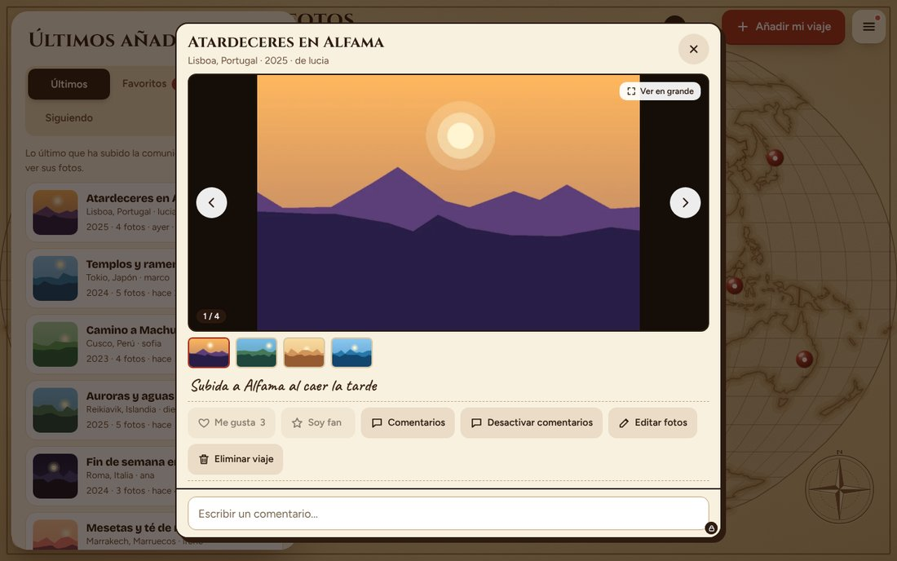

Ver la pantalla: el podio

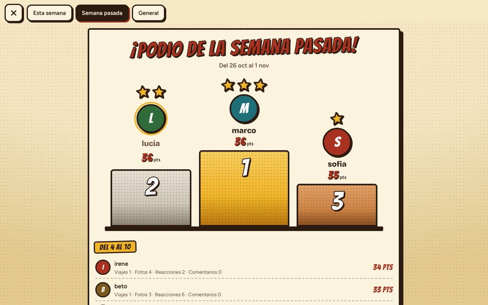

Ver la pantalla: amigos y solicitudes

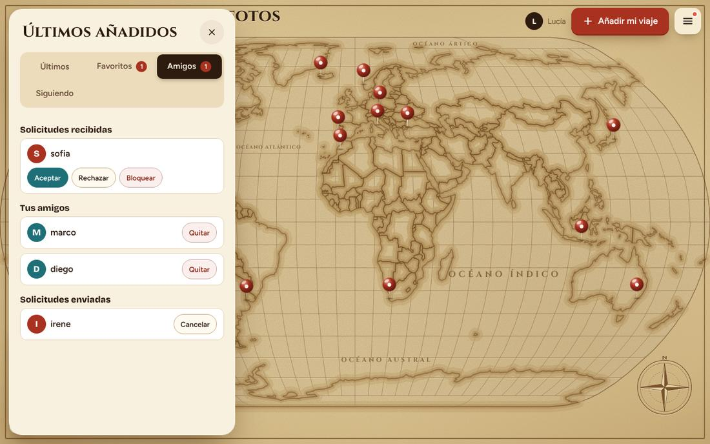

Ver la pantalla: añadir un viaje

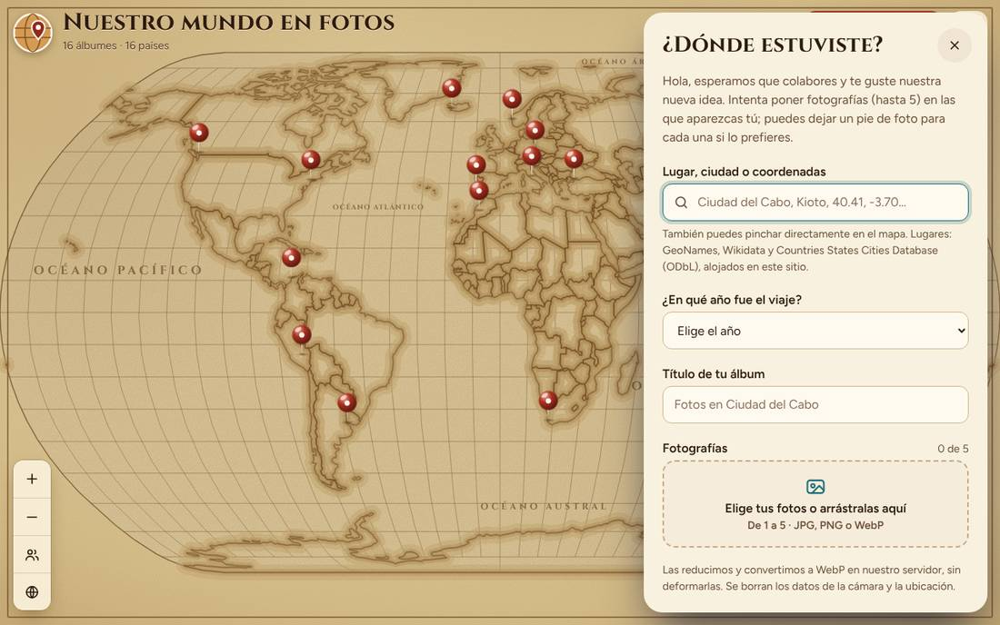

### 2. Panel de administración

En *Componentes › Mapa de viajes* tienes cinco pantallas:

| Pantalla | Qué hace |
|---|---|
| **Panel** | Resumen (por revisar, publicados, álbumes, semanas del ranking, participantes del sorteo) e interruptores que se guardan al momento. |
| **Publicaciones del mapa** | Publicar, despublicar, ocultar, marcar como spam, papelera, eliminar; aprobar o rechazar fotos pendientes y ver los viajes denunciados. |
| **Álbumes del mapa** | Los mapas que ven tus usuarios: título, nivel de acceso, logo y comentarios. |
| **Ranking** | Semanas cerradas del podio y botón para cerrar la semana. |
| **Sorteo** | Participantes con filtros por fechas y puntos, descarga en CSV y sorteo al azar. |

Ver la pantalla: el panel

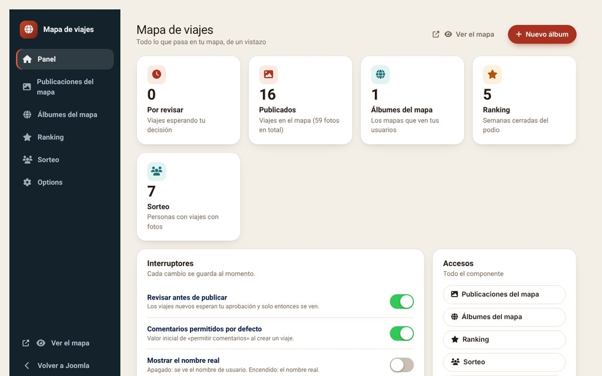

Ver la pantalla: publicaciones del mapa

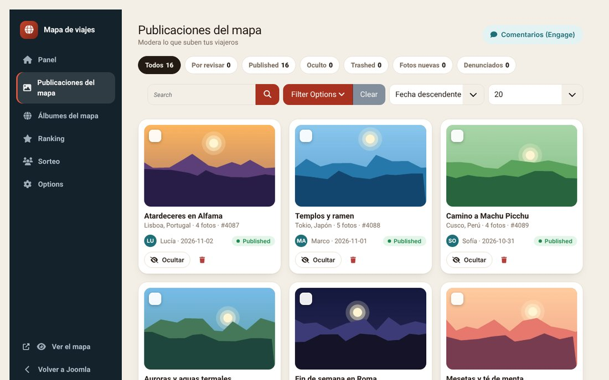

Ver la pantalla: álbumes del mapa

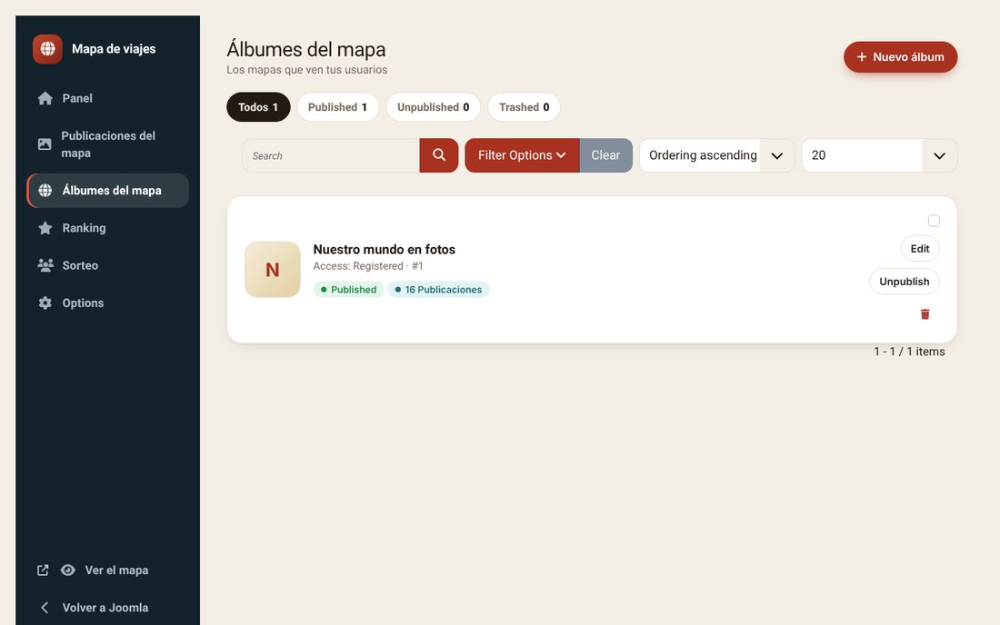

Ver la pantalla: el ranking

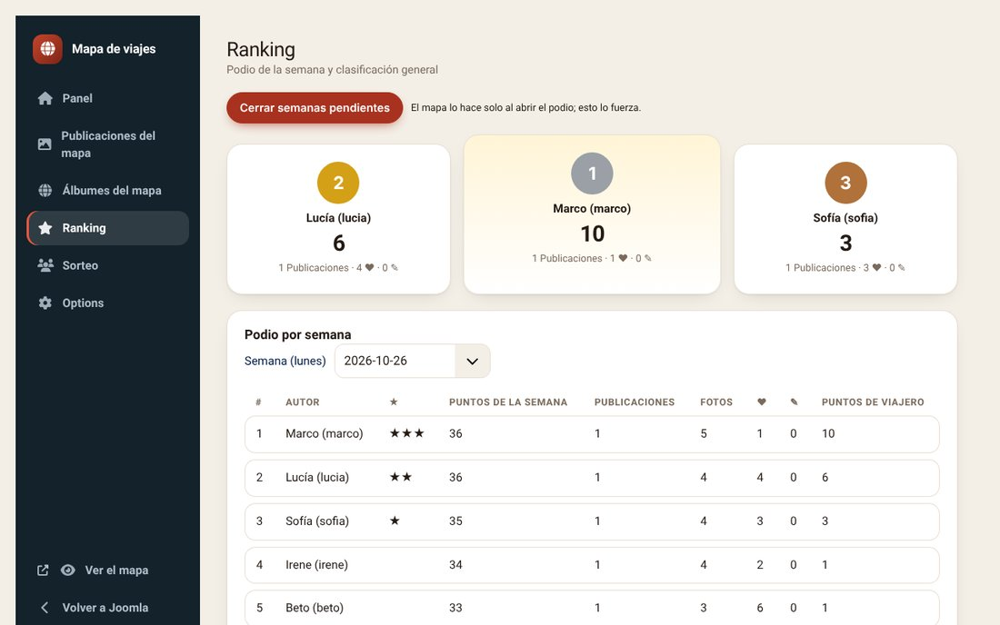

Ver la pantalla: el sorteo

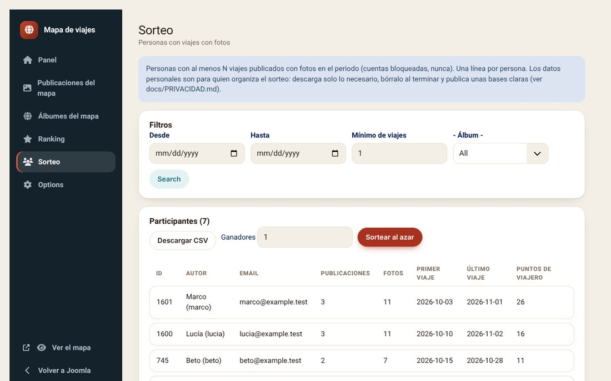

**Interruptores del panel** (se guardan solos; son los mismos ajustes que las opciones de abajo): revisar antes de publicar · comentarios por defecto · mostrar el nombre real · mostrar las fotos de perfil · mostrar el ranking · felicitar por correo al podio · sistema de comentarios · dejar que cada persona elija su mapa · estilo del mapa · avisos por correo.

### 3. Opciones del componente

En *Componentes › Mapa de viajes › Opciones*, una pestaña por apartado.

#### Pestaña «Fotos»

| Opción | Qué hace | Valores |
|---|---|---|
| **Fotos por álbum** | Máximo de fotos en cada publicación (1 a 10). | Número de 1 a 10 (por defecto: 5) |
| **Tamaño del lado largo** | La foto se reduce sin deformarla: horizontal 1000×?, vertical ?×1000. Nunca se amplía. | 800 px · 1000 px · 1600 px (por defecto: 1000 px) |
| **Calidad WebP** | De 50 a 95. Más calidad pesa más. 80 es un buen equilibrio. | Número de 50 a 95 (por defecto: 80) |
| **Peso máximo por foto (MB)** | Se comprueba en el servidor. También depende de upload_max_filesize y post_max_size de PHP. | Número de 1 a 20 (por defecto: 10) |
| **Palabras por pie de foto** | Límite de palabras de cada pie de foto. | Número de 20 a 500 (por defecto: 256) |
| **Carpeta privada de fotos** | Ruta absoluta FUERA de la web si puedes (lo más seguro). Vacío = media/com_mapaviajes_private, protegida con .htaccess y web.config. | Texto |

#### Pestaña «Mapa»

| Opción | Qué hace | Valores |
|---|---|---|
| **Estilo del mapa** | El estilo que ve todo el mundo (salvo quien elija otro, si lo permites). | Uno de los seis estilos (por defecto: pergamino) |
| **CSS propio del mapa** | Para quitar o mover lo que otras extensiones (cookies, chat, accesibilidad…) ponen encima del mapa. Se aplica solo en la pantalla del mapa. Ejemplo: .nexusconsent-revoke-fab{display:none!important} | Texto libre |
| **Entradas extra del menú ☰** | Una por línea: Texto \| qué hacer. «Qué hacer» puede ser una dirección web (https://… o /ruta) o un selector CSS: la entrada pulsa ese elemento de la página aunque lo hayas ocultado con el CSS de arriba. Así puedes esconder el icono de otra extensión y ofrecerlo dentro del menú. Ejemplo: Cookies \| .nexusconsent-revoke-fab. Máximo 8. Una entrada con selector solo se muestra si ese elemento existe en la página. | Texto libre |
| **Dejar que cada persona elija su mapa** | Si está activado, el mapa muestra un botón para cambiar de estilo; la elección se guarda solo en el navegador de cada persona. | Sí / No (por defecto: No) |

#### Pestaña «Moderación y límites»

| Opción | Qué hace | Valores |
|---|---|---|
| **Revisar antes de publicar** | Sí: el álbum espera tu aprobación y solo lo ve su autor. No: se publica al instante y lo revisas después. | Sí / No (por defecto: Sí) |
| **Álbumes por hora y usuario** | Freno contra abusos. | Número de 1 a 50 (por defecto: 3) |
| **Álbumes por día y usuario** | Freno contra abusos. | Número de 1 a 200 (por defecto: 10) |
| **Reacciones nuevas por día y usuario** | Tope de «me gusta» y estrellas nuevos que una persona puede dar en 24 horas. Quitar y volver a poner no cuenta. | Número de 10 a 5000 (por defecto: 300) |
| **Reaccionar a los propios viajes (pruebas)** | Para probar «me gusta» y favoritos con una sola cuenta. Al abrir el mapa al público déjalo en «Nadie»: esas reacciones suman en el podio. | Nadie · Solo Super Users · Todo el mundo (solo pruebas) (por defecto: Solo Super Users) |
| **Sistema de comentarios** | Los comentarios de cada viaje los gestiona otra extensión. «Akeeba Engage / Engage» está probado. «Eventos de contenido» sirve a extensiones que escuchan los eventos de contenido de Joomla con el contexto com_mapaviajes.trip (ver docs/COMENTARIOS.md). | Ninguno · Akeeba Engage / Engage · Eventos de contenido de Joomla (otras extensiones) (por defecto: Ninguno) |
| **Comentarios permitidos por defecto** | Valor inicial del formulario. El usuario puede cambiarlo. | Sí / No (por defecto: Sí) |

#### Pestaña «Ranking semanal»

| Opción | Qué hace | Valores |
|---|---|---|
| **Mostrar el ranking** | Si lo apagas, el botón del podio desaparece del mapa y no se calculan semanas nuevas. | Sí / No (por defecto: Sí) |
| **Puntos por viaje publicado** | Entero de 0 a 1000. | Número de 0 a 1000 (por defecto: 20) |
| **Puntos por foto** | Entero de 0 a 1000. | Número de 0 a 1000 (por defecto: 3) |
| **Puntos por foto «solo amigos»** | Lo que suma cada foto marcada «solo amigos» (las públicas suman lo de «Puntos por foto»). Más baja, porque el ranking es público y casi nadie ve esas fotos. | Número de 0 a 1000 (por defecto: 1) |
| **Puntos por reacción dada** | Entero de 0 a 1000. | Número de 0 a 1000 (por defecto: 1) |
| **Puntos por comentario dejado** | Entero de 0 a 1000. | Número de 0 a 1000 (por defecto: 2) |
| **Máximo de reacciones que cuentan por semana** | Evita que alguien suba puntos a base de pulsar o escribir mucho. | Número de 0 a 500 (por defecto: 20) |
| **Máximo de comentarios que cuentan por semana** | Evita que alguien suba puntos a base de pulsar o escribir mucho. | Número de 0 a 500 (por defecto: 20) |
| **Felicitar por correo al podio** | Al cerrar la semana, un correo a las tres personas del podio. Apagado por defecto: no es un aviso imprescindible. | Sí / No (por defecto: No) |

#### Pestaña «Privacidad»

| Opción | Qué hace | Valores |
|---|---|---|
| **Mostrar el nombre real** | No: se muestra el nombre de usuario (alias). Sí: se muestra el nombre completo de la cuenta. Revisa tu política de privacidad antes de activarlo. | Sí / No (por defecto: No) |
| **Mostrar las fotos de perfil** | Sí: si MiFoto está instalado, las personas que hayan subido foto la enseñan en el podio, los viajes y los amigos (a quien MiFoto permita verla). No: todo el mapa usa la inicial de color. Mira lo que dice tu política de privacidad. | Sí / No (por defecto: Sí) |

#### Pestaña «Avisos por correo»

| Opción | Qué hace | Valores |
|---|---|---|
| **Avisar por correo a quien envía el viaje** | Cuando un moderador publica el viaje o lo rechaza (spam, oculto, papelera) se lo decimos a su autor. | Sí / No (por defecto: Sí) |
| **Avisarme de cada álbum nuevo** | Envía un correo de texto sin enlaces a los destinatarios de abajo. | Sí / No (por defecto: Sí) |
| **Resumen semanal de a quien sigues** | Un correo a la semana (sin enlaces) a quien lo active en el mapa, con los viajes nuevos de la gente que sigue. Apagado = nadie lo recibe. | Sí / No (por defecto: Sí) |
| **Correo de contacto para avisos** | Se enseña en la ventana de «Denunciar», para que cualquiera (aunque no tenga cuenta) pueda avisaros de contenido que no debería estar. Vacío = no se enseña. | Un correo |
| **Quién envía los correos** | Nombre o empresa y contacto, que se imprime al pie de cada correo. Ejemplo: «el sitio de pruebas · Nombre Apellidos · contacto@tuweb.com». Vacío = solo el nombre de la web. | Texto |
| **Destinatarios** | Hasta 5 correos separados por coma. Vacío = el correo del sitio. | Texto |

#### Pestaña «Permisos»

| Permiso | Qué permite |
|---|---|
| **Añadir viajes** | Subir álbumes con fotos al mapa. Por defecto, los usuarios registrados. |
| **Moderar en el mapa** | Ver todas las fotos (también «solo amigos» y pendientes), borrar viajes ajenos y cerrar sus comentarios desde el mapa. Por defecto, Administrator y Super Users. Dalo solo a quien deba moderar. |
| **Crear álbumes del mapa** | Crear mapas en el administrador. |
| **Editar estado, Eliminar, Editar** | Permisos normales de Joomla para las pantallas del administrador. |
| **Acceso, Opciones, Configurar** | Permisos normales de Joomla del componente. |

Ver la pantalla: las opciones del componente

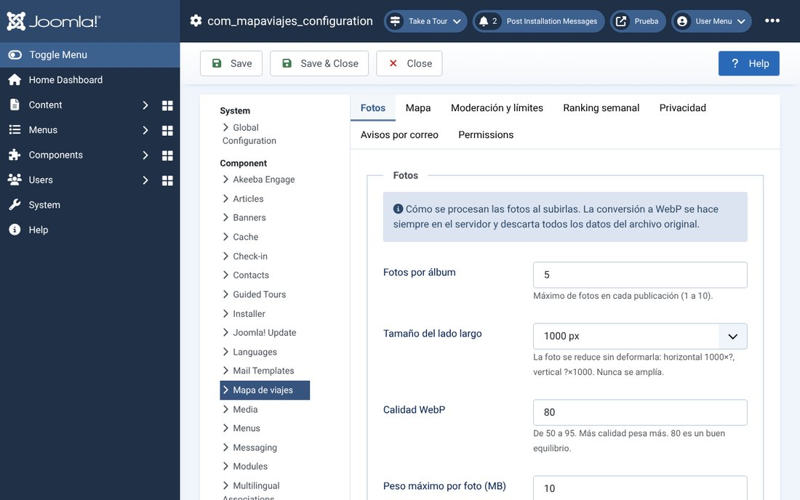

### 4. Plugins incluidos

| Plugin | Qué hace |
|---|---|
| **Contenido › Mapa de viajes** | Códigos para artículos (`{mapaviajes stats}`, `{mapaviajes albums}`, `{mapaviajes countries}`, `{mapaviajes photos}`, con `album=ID` opcional; ver [`docs/CODIGOS-ARTICULO.md`](docs/CODIGOS-ARTICULO.md)) y enlace con Engage para los comentarios de cada viaje. |
| **Privacidad › Mapa de viajes** | Exportación de los datos de una persona (viajes, fotos, amigos, reacciones, ranking…). |
| **Usuario › Mapa de viajes** | Borra todo lo de una persona cuando se elimina su cuenta. |

## Instalar

1. Descarga `pkg_mapaviajes-<versión>.zip` de [la última versión](../../releases/latest).
2. En Joomla: *Sistema › Instalar › Extensiones* y sube el ZIP (incluye el componente y los tres plugins, que se activan solos).
3. Crea un elemento de menú «Mapa de viajes» (o enlaza a `index.php?option=com_mapaviajes`).
4. En *Opciones › Permisos* revisa quién puede añadir viajes y quién puede moderar.
5. En *Opciones › Fotos* pon la carpeta privada de fotos **fuera de la web** si puedes.

Actualizar y desinstalar

- **Actualizar:** sube el ZIP nuevo encima, sin desinstalar. Tus opciones, el CSS propio y las entradas extra del menú se conservan. Al actualizar a la 1.18.1, el permiso «Moderar en el mapa» se crea con lo que ya tenías en «Editar estado» más el grupo Administrator: revísalo en Permisos.
- **Desinstalar:** quita las tablas del componente. Las fotos de la carpeta privada se conservan a propósito; bórralas a mano si ya no las quieres.
- **Generarlo tú:** `php build/build.php` crea `dist/pkg_mapaviajes-<versión>.zip` y rechaza el paquete si trae direcciones externas o código peligroso.

## Seguridad

Lo que de verdad hace el código

- **Quién y cómo:** todo lo que cambia datos exige `POST`, token CSRF de Joomla, cabecera `X-Requested-With` y sesión; la persona sale de la sesión, nunca de lo que manda el navegador.
- **Permisos:** el administrador usa los permisos de Joomla; moderar en el mapa es un permiso propio que Joomla no hereda a ningún grupo.
- **Fotos:** se recodifican siempre a WebP en el servidor sin datos EXIF; el nombre, la extensión y el tipo que declara el navegador se ignoran; se guardan con nombre aleatorio en una carpeta privada servida solo tras comprobar sesión y permiso. Una foto «solo amigos» nunca llega a quien no es amigo.
- **Texto:** solo texto plano; se rechaza (no se «arregla») lo que parezca código, enlaces o manejadores. La salida se escapa siempre y el JavaScript no usa `innerHTML` ni `eval` (lo comprueba el empaquetador).
- **Base de datos:** solo consultas preparadas; los identificadores dinámicos salen de listas cerradas.
- **Terceros:** el mapa no hace peticiones a otros sitios (fuentes, mapas y búsqueda de lugares son locales); el CSS propio no admite `@import` ni `url()` remotos.
- **Privacidad (RGPD):** sin cookies ni analítica propias; exportación y borrado de datos; los avisos por correo no llevan enlaces.
- **Auditorías y pruebas:** [`SECURITY.md`](SECURITY.md), [`docs/AUDITORIA-SEGURIDAD-1.18.md`](docs/AUDITORIA-SEGURIDAD-1.18.md), [`docs/PRIVACIDAD.md`](docs/PRIVACIDAD.md) y [`tests/LEEME.md`](tests/LEEME.md). Lo que no se ha probado está dicho ahí.

## Colaborar: traducciones

Hoy el mapa está en **español** e **inglés**. Si quieres añadir tu idioma, no hace falta programar: copias la plantilla, traduces los textos y los envías por GitHub. Una herramienta del repositorio comprueba la traducción antes de aceptarla (que no falte ninguna clave, que se conserven los marcadores `%s` y `%d`, y que no lleve HTML, scripts ni direcciones externas). Solo se aceptan idiomas completos, se revisan a mano y salen en la siguiente versión con tu crédito.

- **Guía paso a paso:** [`docs/TRADUCIR.md`](docs/TRADUCIR.md)
- **Ofrecer una traducción:** [formulario de GitHub](../../issues/new?template=traduccion.yml)
- **Cómo colaborar y avisar de un fallo de seguridad en privado:** [`CONTRIBUTING.md`](CONTRIBUTING.md)

## Autor y licencia

Desarrollado por **ChasKa** · Licencia **GNU GPL v3 o posterior** ([`LICENSE`](LICENSE)). Creado y dirigido por ChasKa con asistencia de IA (Claude, de Anthropic).

Componentes de terceros incluidos

| Componente | Para qué | Licencia |
|---|---|---|
| [Bricolage Grotesque, Figtree, Cinzel y Caveat](https://fontsource.org) | Tipografías, servidas desde tu servidor | SIL Open Font License 1.1 |
| [Natural Earth](https://www.naturalearthdata.com) (vía `world-atlas`, `topojson-client` y `d3-geo`) | Contornos de países y proyección del mapa | Dominio público (los datos) |
| [Countries States Cities Database](https://github.com/dr5hn/countries-states-cities-database) | ~127 000 ciudades para buscar el lugar, con nombres en español | ODbL 1.0 |
| [libheif-js](https://github.com/catdad-experiments/libheif-js) | Leer fotos HEIC en el navegador | LGPL-3.0 |

Detalle y textos de licencia: [`NOTICE.md`](NOTICE.md). El estilo del panel de administración se inspira en el de Engage, un fork de Akeeba Engage (GPL v3 o posterior); no se ha copiado código.

*Joomla!® es una marca registrada de Open Source Matters, Inc. Este proyecto no está afiliado ni respaldado por Joomla, Akeeba ni Open Source Matters.*
